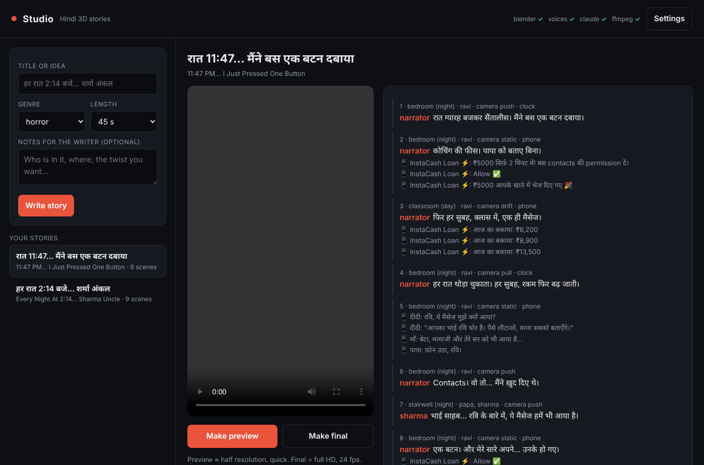

# Studio: type a title, get a finished video

A desktop tool in the spirit of ChannelRecipe Studio, built for one style first:
**Hindi 3D stories** (recurring characters, crime / horror tragedies, Shorts
first) rendered in Blender, so every character looks the same in every shot.

## How it will work

1. **Title in.** The desktop app (a local page in your browser) takes a
   title or idea, the length (Short 30–60 s, or long), and the cast.
2. **Script.** The writer calls the Claude Code CLI on your computer
   (`claude -p`, your own Claude account) and gets back a shot list in
   JSON: sets, characters, actions, camera, Hindi dialogue and on-screen
   text.
3. **Voice.** Kokoro Hindi voices (offline) speak each line.
4. **3D.** Blender builds the sets and characters from code, animates each
   shot and renders it (EEVEE on your GPU).
5. **Edit.** Captions in Devanagari, phone-screen overlays, theme cards,
   music and sound effects, then a 9:16 MP4 plus thumbnail and description.

## Install (Windows or Mac)

1. Install **Python 3.11+**, **ffmpeg** and **Claude Code** (`npm install -g @anthropic-ai/claude-code`, then run
   `claude` once to log in with your Claude account).
2. Run `python3 studio/setup_studio.py`. It installs the Python packages, downloads Blender 4.5 LTS and the
   Hindi voice model into `~/.studio`, and checks everything.
3. Double-click `studio/Studio.command` (Mac) or `studio/Studio.bat` (Windows). The app opens in your browser.

In the app: type a title → **Write story** (about a minute) → read the scenes, edit if you like →
**Make preview** (quick, half resolution) → **Make final** (full HD, 24 fps). The MP4, thumbnail and a
description appear next to the player.



## Layout

| Path | What |
|---|---|
| `blender/character.py` | Procedural character rig: black sphere head, white eyes with eyelids, tube limbs, mitten hands; outfit colours plus one accessory (headband, cap, bun, dupatta, glasses, long hair); poses and expressions |
| `blender/sets.py` | Reusable sets with lights and anchor points: bedroom, Kota coaching classroom, society stairwell |
| `blender/animate.py` | Per-frame animation: pose blends, walk cycle (also up stairs), blinks, breathing, head turns, eyelid expressions, camera moves (push, pull, drift, rise, static) with handheld shake |
| `blender/props.py` | Hand props: phone with a glowing screen, book, bag |
| `blender/render_shot.py` | Renders one shot JSON to PNG frames (or a single still) |
| `cast/default.json` | The recurring cast: Ravi, Meera, Papa, Maa, Sharma uncle |
| `examples/sets/*.json` | Example shots for each set |
| `blender/test_scene.py` | Smoke test: one character in the bedroom as a 9:16 still |
| `make_short.py` | Story file → MP4: Hindi voices, Blender renders (cached per scene), overlays, sound, mux |
| `overlays.py` | Devanagari captions (colour per speaker), clock stamps, phone chats, black theme cards |
| `catalog.py` | What the engine can render (sets, anchors, poses…) and the story validator |
| `writer.py` | Title → story via `claude -p`, validated, with one automatic repair round |
| `app.py`, `ui.html` | The desktop app (local web page) |
| `setup_studio.py` | One-time installer: packages, Blender, voice model, checks |
| `stories/*/story.json` | Stories; 001 hand-written, 002 written by the writer |

## Milestones

- [x] M1 Blender pipeline runs headless; first character and set
- [x] M2 Shot renderer: keyframed actions (walk, sit, look, blink, phone), camera moves, three Indian sets (bedroom, coaching class, society stairwell)
- [x] M3 Story JSON + compositor + Hindi voice → first 45 s Hindi Short end to end
- [x] M4 Writer: title → story JSON via `claude -p`
- [x] M5 Desktop app page + installer for Windows and Mac (needs a real test on your computer)
- [ ] M6 More styles (Bureau rules files, long-form)

## Render a shot

```
blender -b -P studio/blender/render_shot.py -- studio/examples/sets/stairwell.json \
    studio/cast/default.json out/ --fps 12 --scale 0.35 --samples 10
```

Eyes and eyelids are painted on the head by its material (two ovals plus a
lid line driven by `close` and `tilt`), so expressions stay perfectly flush.

## Run the smoke test

```
blender -b -P studio/blender/test_scene.py -- out.png CYCLES
```

Blender 4.5 LTS. Cycles works anywhere; EEVEE needs a GPU (fast on a desktop,
about 45 s a frame on a CPU-only server).
